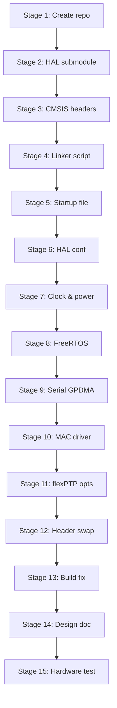

# Port flexPTP Demo to NUCLEO-H563ZI — Implementation Plan

## Implementation Checklist

- [x] **Stage 1** — Create new repository, copy structure
- [x] **Stage 2** — Swap HAL submodule (`stm32h7xx` → `stm32h5xx`)
- [ ] **Stage 3** — Add CMSIS H5 device headers
- [ ] **Stage 4** — New linker script (flat SRAM layout)
- [ ] **Stage 5** — New startup file (H563 vector table)
- [ ] **Stage 6** — `stm32h5xx_hal_conf.h`
- [ ] **Stage 7** — Clock & power init (`main.c` rewrite, `HSE_BYPASS`)
- [ ] **Stage 8** — `FreeRTOSConfig.h` (M33 + 250 MHz)
- [ ] **Stage 9** — `serial_io.c` (GPDMA rewrite)
- [ ] **Stage 10** — `mac_drv.c/h` (register audit + port)
- [ ] **Stage 11** — `flexptp_options.h` (PTP 200 MHz / 5 ns)
- [ ] **Stage 12** — Global HAL header swap
- [ ] **Stage 13** — Build & fix compilation
- [ ] **Stage 14** — Create `docs/design_doc.md`
- [ ] **Stage 15** — Flash & test on hardware

---

## Resolved Design Decisions

| Decision | Resolution |
|---|---|
| **Repository** | New repository `flexPTP-demo-NUCLEO-H563ZI` |
| **PTP Clock** | 200 MHz (PLL1_Q), 5 ns increment — matches H7 config. Design doc will include 250 MHz optimization guide. |
| **HSE Mode** | `RCC_HSE_BYPASS` — stock Nucleo board (ST-Link MCO at 8 MHz) |
| **Double-Precision FPU** | Keep `double` in Kalman filter. Accept software emulation cost on M33 SP-FPU. |
| **Network Stack** | LwIP only for initial port. Design doc will cover EtherLib porting steps. |
| **TrustZone** | Non-secure flat mode (TZEN=0, `ARM_CM33_NTZ`). Design doc will cover TrustZone migration. |
| **RXER Pin (PG2)** | Dropped from GPIO init. Design doc will note this. |
| **mac_drv.c Strategy** | Register-level port (audit every register). Design doc will compare custom driver vs STM32 HAL vs existing H7 implementation. |
| **PPS Output Pin** | Needs datasheet verification during implementation. |

---

## Hardware & Software Differences Summary

| Aspect | NUCLEO-H743ZI (Current) | NUCLEO-H563ZI (Target) |
|---|---|---|
| **Core** | Cortex-M7 (ARMv7-M) | Cortex-M33 (ARMv8-M) |
| **Max Clock** | 480 MHz | 250 MHz |
| **FPU** | Double-precision (DP) | Single-precision (SP) only |
| **L1 Cache** | 16KB I-Cache + 16KB D-Cache (integrated) | ICACHE + DCACHE controllers (system-level) |
| **Flash** | 1 MB @ `0x08000000` | 2 MB @ `0x08000000` |
| **RAM** | ITCM 64KB, DTCM 128KB, AXI-SRAM 320KB, D2 32KB, D3 16KB | SRAM1 256KB, SRAM2 64KB, SRAM3 320KB (flat) |
| **Unique ID** | `0x1FF1E800` | `0x08FFF800` |
| **Ethernet PHY** | LAN8742A (RMII) | LAN8742A (RMII) ✅ same |
| **USART3 VCP** | PD8 TX / PD9 RX | PD8 TX / PD9 RX ✅ same |
| **ETH RMII Pins** | PA1/PA2/PA7/PB13/PC1/PC4/PC5/PG11/PG13 | PA1/PA2/PA7/PB13/PC1/PC4/PC5/PG11/PG13 ✅ same |
| **PPS Pin** | PB5 (AF11) | TBD — needs datasheet verification |
| **RXER Pin** | PG2 (AF11) | **Dropped** — not connected on H563 Nucleo |
| **DMA Architecture** | DMA1/DMA2 (stream-based) | GPDMA (channel-based, linked-list) |
| **Eth Clock Enables** | `ETH1MAC`, `ETH1TX`, `ETH1RX` | `ETH`, `ETHTX`, `ETHRX` (H5 naming) |
| **Clock Domains** | D1/D2/D3 with APB1–APB4 | Flat AHB + APB1/APB2/APB3 |
| **Power Config** | `PWR_LDO_SUPPLY`, VOS0 for >400 MHz | VOS0 for 250 MHz, no supply selection API |
| **TrustZone** | No | Yes (disabled, TZEN=0) |
| **HAL Package** | `stm32h7xx-hal-driver` | `stm32h5xx-hal-driver` |
| **FreeRTOS Port** | `portable/GCC/ARM_CM7/r0p1` | `portable/GCC/ARM_CM33_NTZ/non_secure` |

---

## Stage Details

### Stage 1 — Create new repository, copy structure

Create `flexPTP-demo-NUCLEO-H563ZI` as a new project at `/home/damien/git/flexPTP-demo-NUCLEO-H563ZI`:
- `git init`
- Copy the directory structure from the H743 project (Src/, Inc/, Drivers/EthDrv/, Drivers/CMSIS/, Modules/, cmake/, toolchains/, .vscode/)
- Copy all application source files (Src/, Inc/)
- Copy build infrastructure (CMakeLists.txt, CMakePresets.json, build.sh, cmake/, .clang-format, .gitignore)
- Copy Modules/ submodule configs (flexPTP, embfmt, lwip, blocking_io) — keep EtherLib in `.gitmodules` but it won't be compiled
- Do NOT copy: H7 HAL submodule, H7 linker script, H7 startup file, H7 HAL conf header
- Copy LICENSE, README.md (to be updated later)
- Create `docs/` directory with this implementation plan
- Create initial `docs/design_doc.md` skeleton

**Commit**: `"Stage 1: Initialize H563ZI project structure"`

---

### Stage 2 — Swap HAL submodule

- Add git submodule: `Drivers/stm32h5xx-hal-driver` from `https://github.com/STMicroelectronics/stm32h5xx-hal-driver.git`
- Update `.gitmodules` to reference the H5 HAL instead of H7
- Remove any leftover H7 HAL references from `.gitmodules`

**Commit**: `"Stage 2: Add stm32h5xx-hal-driver submodule"`

---

### Stage 3 — Add CMSIS H5 device headers

- Add `Drivers/CMSIS/Device/ST/STM32H5xx/Include/` with:
  - `stm32h563xx.h`
  - `stm32h5xx.h`
  - `system_stm32h5xx.h`
- Source from ST's STM32CubeH5 CMSIS device package
- Update `Drivers/CMSIS/CMakeLists.txt` to reference H5 device include paths
- Remove H7 device headers (`stm32h735xx.h`, `stm32h743xx.h`, `stm32h7xx.h`, `system_stm32h7xx.h`)

**Commit**: `"Stage 3: Add CMSIS STM32H5xx device headers"`

---

### Stage 4 — New linker script

Create `stm32h563zitx_FLASH.ld` with flat SRAM layout:

```
MEMORY
{
  FLASH (rx)  : ORIGIN = 0x08000000, LENGTH = 2048K
  SRAM1 (rwx) : ORIGIN = 0x20000000, LENGTH = 256K
  SRAM2 (rwx) : ORIGIN = 0x20040000, LENGTH = 64K
  SRAM3 (rwx) : ORIGIN = 0x20050000, LENGTH = 320K
}
```

- `.data`, `.bss`, stack, heap → **SRAM1**
- `.EthBufferSection`, `.ETHStateAndDecripSection` → **SRAM3**
- `.FreeRTOSHeapSection` → **SRAM1**
- Remove ITCMRAM, DTCMRAM, RAM_D1/D2/D3 regions
- Delete `stm32h735igkx_FLASH.ld`

**Commit**: `"Stage 4: Add STM32H563ZI linker script"`

---

### Stage 5 — New startup file

Create `Startup/startup_stm32h563zitx.s`:
- `.cpu cortex-m33`
- Full STM32H563 vector table (different IRQ numbering)
- GPDMA channel IRQ handlers instead of DMA stream handlers
- Standard Reset_Handler with .data/.bss init
- Delete `Startup/startup_stm32h735igkx.s`

**Commit**: `"Stage 5: Add STM32H563ZI startup file"`

---

### Stage 6 — HAL configuration header

Create `Inc/stm32h5xx_hal_conf.h`:
- All `#include "stm32h7xx_hal_*.h"` → `#include "stm32h5xx_hal_*.h"`
- Module enable/disable macros for H5
- `HSE_VALUE` = `8000000UL` (unchanged)
- `UNIQUE_DEV_ID_BASE` = `0x08FFF800` (was `0x1FF1E800`)
- `ETH_TX_DESC_CNT` / `ETH_RX_DESC_CNT` = 24 (unchanged)
- Remove H7-specific callback macros (SAI, CORDIC, DFSDM, etc.)
- Delete `Inc/stm32h7xx_hal_conf.h`

**Commit**: `"Stage 6: Add stm32h5xx HAL configuration header"`

---

### Stage 7 — Clock & power init

Rewrite clock/power sections of `Src/main.c`:
- `init_osc_and_clk()`: Remove `HAL_PWREx_ConfigSupply()`, use H5 voltage scaling API, HSE_BYPASS
- `init_pll()`: Target 250 MHz SYSCLK, PLL1_Q = 200 MHz, FLASH_LATENCY_5
- `init_randomizer()`: Update RNG clock enable for H5
- `init_mpu()`: ARMv8-M MPU disable
- Update all HAL header includes
- Update welcome message

**Commit**: `"Stage 7: Port clock, power, and system init to STM32H5"`

---

### Stage 8 — FreeRTOS configuration

Update `Inc/FreeRTOSConfig.h`:
- `configCPU_CLOCK_HZ` = `250000000`
- Add `configENABLE_TRUSTZONE 0`, `configRUN_FREERTOS_SECURE_ONLY 0`, `configENABLE_FPU 1`, `configENABLE_MPU 0`
- Verify port interrupt handler mappings for M33

**Commit**: `"Stage 8: Configure FreeRTOS for Cortex-M33 @ 250 MHz"`

---

### Stage 9 — Serial I/O GPDMA rewrite

Rewrite DMA sections of `Src/standard_output/serial_io.c`:
- GPDMA channel config instead of DMA1 stream config
- `__HAL_RCC_GPDMA1_CLK_ENABLE()`
- `GPDMA1_Channel0_IRQHandler` instead of `DMA1_Stream0_IRQHandler`
- USART3 GPIO stays identical (PD8/PD9 AF7)

**Commit**: `"Stage 9: Port serial I/O DMA to GPDMA"`

---

### Stage 10 — Ethernet MAC driver port

Register-level port of `Drivers/EthDrv/mac_drv.c`:
- GPIO: Remove PG2, update clock enables
- MDIO clock divider recalculation
- Audit all ETH register accesses against H5 reference manual
- Port PTP timestamp register functions
- Update `mac_drv.h` includes
- Update `phy_common.c` HAL header

**Commit**: `"Stage 10: Port mac_drv.c to STM32H5 registers"`

---

### Stage 11 — flexPTP options

Update `Inc/flexptp_options.h`:
- `PTP_MAIN_OSCILLATOR_FREQ_HZ` = `200000000`
- `PTP_INCREMENT_NSEC` = `5`
- Verify/update PTP port file includes

**Commit**: `"Stage 11: Configure flexPTP for H5 PTP clock"`

---

### Stage 12 — Global HAL header swap

Search-and-replace across all remaining files:
- `stm32h7xx_hal.h` → `stm32h5xx_hal.h`
- `stm32h7xx_ll_rng.h` → `stm32h5xx_ll_rng.h`
- `stm32h7xx.h` → `stm32h5xx.h`

Files: `eth_drv_lwip.c`, `eth_drv_etherlib.c`, and any others still referencing H7 headers.

**Commit**: `"Stage 12: Complete HAL header migration to stm32h5xx"`

---

### Stage 13 — Build & fix compilation

- Update `CMakeLists.txt`: MCU flags, linker script, startup file, HAL paths, CMSIS paths, FreeRTOS port
- Update `Drivers/CMakeLists.txt`: H5 HAL sources
- `cmake --preset debug && cmake --build build/debug`
- Fix all compilation errors and warnings
- Target: clean build with `-Wall -Wextra`

**Commit**: `"Stage 13: Fix build for STM32H563ZI target"`

---

### Stage 14 — Design documentation

Create `docs/design_doc.md` with:
- PTP Clock Optimization Guide (200 MHz → 250 MHz)
- EtherLib Porting Guide
- TrustZone Migration Guide
- RXER Pin Note
- mac_drv.c Comparison (custom vs HAL vs H7)

**Commit**: `"Stage 14: Add design documentation"`

---

### Stage 15 — Flash & test on hardware

- Flash firmware to NUCLEO-H563ZI board
- Verify: serial output, DHCP, PTP sync, 1PPS, CLI
- Document results in design doc

**Commit**: `"Stage 15: Hardware verification results"`

---

## Execution Flow



---

## Verification Plan

### Build Verification
- `cmake --preset debug && cmake --build build/debug` — clean compile, zero errors/warnings

### Functional Verification (requires hardware)
1. **Boot & Serial Output**: USART3 VCP at 115200 — welcome message appears
2. **DHCP**: Ethernet link-up → DHCP address acquired and printed
3. **PTP Sync**: Run against a PTP grandmaster → verify `ptp log` shows converging offset
4. **1PPS Output**: Measure PPS pulse on oscilloscope — verify frequency and jitter
5. **CLI**: All flexPTP CLI commands respond correctly (`?`, `flexptp`, profile switching)

### Regression
- Original H743 project is a separate repository — unaffected
