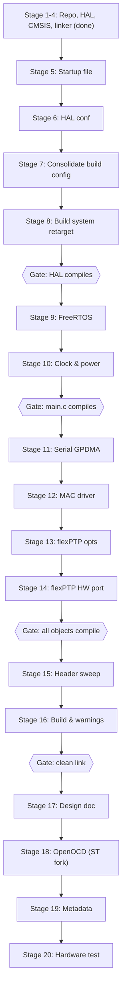

# Port flexPTP Demo to NUCLEO-H563ZI — Implementation Plan

> **Revision note.** Stages 5 onward were renumbered during plan review. Five stages were
> added (build-config consolidation, build-system retarget, flexPTP hardware port, OpenOCD
> provisioning, project metadata), and the build system was pulled forward so the project
> can be compiled incrementally rather than only at the end. Stages 1–4 are unchanged and
> already committed.
> The review itself — every finding, its evidence, and what was checked and found clean —
> is recorded in [port_review.md](port_review.md).

## Implementation Checklist

- [x] **Stage 1** — Create new repository, copy structure
- [x] **Stage 2** — Swap HAL submodule (`stm32h7xx` → `stm32h5xx`)
- [x] **Stage 3** — Add CMSIS H5 device headers
- [x] **Stage 4** — New linker script (flat SRAM layout)
- [x] **Stage 5** — New startup file (H563 vector table)
- [x] **Stage 6** — `stm32h5xx_hal_conf.h`
- [x] **Stage 7** — Consolidate build config into `CMakeLists.txt` 🆕
- [x] **Stage 8** — Build-system retarget (CMake, MCU flags, HAL sources) 🆕
- [x] **Stage 9** — FreeRTOS configuration + kernel port selection
- [x] **Stage 10** — Clock & power init (`main.c`)
- [x] **Stage 11** — `serial_io.c` (GPDMA rewrite)
- [x] **Stage 12** — `mac_drv.c/h` (register audit + port)
- [x] **Stage 13** — `flexptp_options.h` (PTP `pll1_q_ck` 250 MHz / 5 ns)
- [x] **Stage 14** — flexPTP H563 hardware port 🆕
- [x] **Stage 15** — Global HAL header sweep
- [ ] **Stage 16** — Build & warning cleanup
- [ ] **Stage 17** — Complete `docs/design_doc.md`
- [ ] **Stage 18** — Provision ST's OpenOCD via `build.sh` 🆕
- [ ] **Stage 19** — Project metadata & tooling (README, build.sh, VS Code) 🆕
- [ ] **Stage 20** — Flash & test on hardware

### Build gates

The original plan deferred all compilation to a single stage at the end. Instead, run a
build at each of these points and do not proceed until it passes:

| After | Expected result |
|---|---|
| Stage 8 | `cmake --preset debug` configures; the H5 HAL static library compiles |
| Stage 10 | `main.c` compiles — note it pulls in `mac_drv.h`, so a full build needs Stage 12; verify in isolation until then |
| Stage 14 | All application objects compile; link may still fail |
| Stage 16 | Clean link, zero warnings under `-Wall -Wextra` |

---

## Resolved Design Decisions

| Decision | Resolution |
|---|---|
| **Repository** | New repository `flexPTP-demo-NUCLEO-H563ZI` |
| **PTP Clock** | **HCLK 250 MHz, 5 ns increment.** The H563 has no ETH PTP clock mux, so HCLK is the only source; 5 ns is the smallest usable increment. Supersedes the earlier "200 MHz via PLL1_Q" decision — see [ptp_clock.md](ptp_clock.md). |
| **HSE Mode** | `RCC_HSE_BYPASS` — stock Nucleo board (ST-Link MCO at 8 MHz) |
| **Double-Precision FPU** | Keep `double` in Kalman filter. Accept software emulation cost on M33 SP-FPU. The servo runs once per Sync (1–8 Hz), so the cost is immaterial. |
| **Network Stack** | LwIP only for initial port. Design doc will cover EtherLib porting steps. |
| **TrustZone** | Non-secure flat mode (TZEN=0, `ARM_CM33_NTZ`). Design doc will cover TrustZone migration. |
| **RXER Pin (PG2)** | Dropped from GPIO init. Design doc will note this. |
| **ETH_TXD1 Pin** | **PB15** (AF11) on NUCLEO-H563ZI — *differs* from the H743 board, which uses PB13. Confirmed against board documentation. |
| **mac_drv.c Strategy** | Register-level port. Register audit already done during review: every ETH register and descriptor bit the driver touches exists on the H563 with identical names — see Stage 12. |
| **PPS Output Pin** | **PG8** (AF11), same as the H743 project. Configured by the flexPTP hardware port (Stage 14), *not* by `mac_drv.c`. The H743 driver's stray PB5 configuration is dropped — see Stage 12. |
| **Submodule pins** | **Keep the newer pins** (all four are ahead of the H743 reference). flexPTP `76aaf67` carries `3601a6f`, an atomicity fix in `ptphw_gettime()`; pinning back would reintroduce a timestamp bug. Costs the F47 and F48 workarounds — see [design_doc.md](design_doc.md#submodule-pinning). |
| **FreeRTOS kernel version** | Pin `FetchContent` to a release tag. `GIT_TAG main` is a floating dependency on a port being actively changed. |
| **MCU compiler flags** | **Absorbed into `CMakeLists.txt`; `cmake/vscode_generated.cmake` is deleted** (Stage 7). The generated file was marked "shall not be touched by user", so editing it in place left the MCU configuration one extension-regeneration away from reverting. |
| **Flash / debug tool** | **ST's OpenOCD fork**, built from source by `build.sh --with-openocd` into `toolchains/` (Stage 18). Upstream/distro OpenOCD 0.12.0 has no `stm32h5x` flash driver and cannot program this part. |

---

## Hardware & Software Differences Summary

| Aspect | NUCLEO-H743ZI (Current) | NUCLEO-H563ZI (Target) |
|---|---|---|
| **Core** | Cortex-M7 (ARMv7-M) | Cortex-M33 (ARMv8-M) |
| **Max Clock** | 480 MHz | 250 MHz |
| **FPU** | Double-precision (DP) | Single-precision (SP) only |
| **L1 Cache** | 16KB I-Cache + 16KB D-Cache (integrated) | ICACHE + DCACHE controllers (system-level, **both off after reset**; `HAL_Init()` does not enable either) |
| **Flash** | 1 MB @ `0x08000000` | 2 MB @ `0x08000000` |
| **RAM** | ITCM 64KB, DTCM 128KB, AXI-SRAM 320KB, D2 32KB, D3 16KB | SRAM1 256KB, SRAM2 64KB, SRAM3 320KB (flat) |
| **Unique ID** | `0x1FF1E800` | `0x08FFF800` |
| **Ethernet PHY** | LAN8742A (RMII) | LAN8742A (RMII) ✅ same |
| **USART3 VCP** | PD8 TX / PD9 RX | PD8 TX / PD9 RX ✅ same |
| **ETH RMII Pins** | PA1/PA2/PA7/**PB13**/PC1/PC4/PC5/PG11/PG13 | PA1/PA2/PA7/**PB15**/PC1/PC4/PC5/PG11/PG13 ⚠️ TXD1 moved |
| **ETH_TXD1** | PB13 (AF11) | **PB15** (AF11) — must be changed in `mac_drv.c` |
| **PPS Pin** | PG8 (AF11, set by flexPTP port); PB5 also configured in `mac_drv.c` | **PG8** (AF11), set by the flexPTP port only — PB5 dropped |
| **RXER Pin** | PG2 (AF11) | **Dropped** — not connected on H563 Nucleo |
| **ETH PTP clock** | HCLK (240 MHz) | **`pll1_q_ck` (250 MHz)** — no `ETHPTPCLKSEL` mux on this device; RM0481 Table 121 hardwires mux-less parts to `pll1_q_ck`. PLL1Q output must be explicitly enabled. |
| **DMA Architecture** | DMA1/DMA2 (stream-based) | GPDMA (channel-based, linked-list) |
| **Eth Clock Enables** | `ETH1MAC`, `ETH1TX`, `ETH1RX` | `ETH`, `ETHTX`, `ETHRX` (H5 naming) |
| **SYSCFG** | `SYSCFG` (`__HAL_RCC_SYSCFG_CLK_ENABLE`, `HAL_SYSCFG_*`) | Renamed **`SBS`** (`__HAL_RCC_SBS_CLK_ENABLE`, `HAL_SBS_*`) |
| **Clock Domains** | D1/D2/D3 with APB1–APB4 | Flat AHB + APB1/APB2/APB3 |
| **Power Config** | `HAL_PWREx_ConfigSupply(PWR_LDO_SUPPLY)`, VOS0 for >400 MHz | VOS0 for 250 MHz. `HAL_PWREx_ConfigSupply()` exists but only accepts `PWR_EXTERNAL_SOURCE_SUPPLY` — drop the call. |
| **TrustZone** | No | Yes (disabled, TZEN=0) |
| **HAL Package** | `stm32h7xx-hal-driver` | `stm32h5xx-hal-driver` |
| **FreeRTOS Port** | `portable/GCC/ARM_CM7/r0p1` | `portable/GCC/ARM_CM33_NTZ/non_secure` |

---

## Stage Details

### Stage 1 — Create new repository, copy structure

Create `flexPTP-demo-NUCLEO-H563ZI` as a new project at `/home/damien/git/flexPTP-demo-NUCLEO-H563ZI`:
- `git init`
- Copy the directory structure from the H743 project (Src/, Inc/, Drivers/EthDrv/, Drivers/CMSIS/, Modules/, cmake/, toolchains/, .vscode/)
- Copy all application source files (Src/, Inc/)
- Copy build infrastructure (CMakeLists.txt, CMakePresets.json, build.sh, cmake/, .clang-format, .gitignore)
- Copy Modules/ submodule configs (flexPTP, embfmt, lwip, blocking_io) — keep EtherLib in `.gitmodules` but it won't be compiled
- Do NOT copy: H7 HAL submodule, H7 linker script, H7 startup file, H7 HAL conf header
- Copy LICENSE, README.md (to be updated later)
- Create `docs/` directory with this implementation plan
- Create initial `docs/design_doc.md` skeleton

**Commit**: `"Stage 1: Initialize H563ZI project structure"`

---

### Stage 2 — Swap HAL submodule

- Add git submodule: `Drivers/stm32h5xx-hal-driver` from `https://github.com/STMicroelectronics/stm32h5xx-hal-driver.git`
- Update `.gitmodules` to reference the H5 HAL instead of H7
- Remove any leftover H7 HAL references from `.gitmodules`

**Commit**: `"Stage 2: Add stm32h5xx-hal-driver submodule"`

---

### Stage 3 — Add CMSIS H5 device headers

- Add `Drivers/CMSIS/Device/ST/STM32H5xx/Include/` with:
  - `stm32h563xx.h`
  - `stm32h5xx.h`
  - `system_stm32h5xx.h`
- Source from ST's STM32CubeH5 CMSIS device package
- Update `Drivers/CMSIS/CMakeLists.txt` to reference H5 device include paths
- Remove H7 device headers (`stm32h735xx.h`, `stm32h743xx.h`, `stm32h7xx.h`, `system_stm32h7xx.h`)

**Commit**: `"Stage 3: Add CMSIS STM32H5xx device headers"`

*Follow-up owed:* replacing `Src/system_stm32h7xx.c` with `system_stm32h5xx.c` left a dangling
reference in `Src/CMakeLists.txt`. Fixed in Stage 8.

---

### Stage 4 — New linker script

Create `stm32h563zitx_FLASH.ld` with flat SRAM layout:

```
MEMORY
{
  FLASH (rx)  : ORIGIN = 0x08000000, LENGTH = 2048K
  SRAM1 (rwx) : ORIGIN = 0x20000000, LENGTH = 256K
  SRAM2 (rwx) : ORIGIN = 0x20040000, LENGTH = 64K
  SRAM3 (rwx) : ORIGIN = 0x20050000, LENGTH = 320K
}
```

- `.data`, `.bss`, stack, heap → **SRAM1**
- `.ETHBufferSection`, `.ETHStateAndDecripSection` → **SRAM3**
- `.FreeRTOSHeapSection` → **SRAM1**
- `.lwIPHeapSection` → **SRAM3**
- Remove ITCMRAM, DTCMRAM, RAM_D1/D2/D3 regions
- Delete `stm32h735igkx_FLASH.ld`

**Notes:** SRAM2 (64 KB) is deliberately left unallocated — spare capacity. The EtherLib
pool section `.ETHLibPool` has no placement (it had none upstream either); this only
matters if EtherLib is enabled, and is covered by the EtherLib guide in Stage 17.

**Commit**: `"Stage 4: Add STM32H563ZI linker script"`

---

### Stage 5 — New startup file

Create `Startup/startup_stm32h563zitx.s`:
- `.cpu cortex-m33`
- Full STM32H563 vector table (different IRQ numbering; the H743 project actually used an
  **H735** vector table, so do not diff against it — generate from the H563 reference)
- GPDMA channel IRQ handlers instead of DMA stream handlers
- `ETH_IRQn` is position **106** on the H563
- Standard Reset_Handler with .data/.bss init
- Delete `Startup/startup_stm32h735igkx.s`

**Commit**: `"Stage 5: Add STM32H563ZI startup file"`

---

### Stage 6 — HAL configuration header

Create `Inc/stm32h5xx_hal_conf.h`, based on
`Drivers/stm32h5xx-hal-driver/Inc/stm32h5xx_hal_conf_template.h`:
- Enable modules actually used: `HAL`, `CORTEX`, `DMA`, `ETH`, `FLASH`, `GPIO`, `PWR`,
  `RCC`, `RNG`, `TIM`, `UART`, `CRC`
- **`USE_HAL_UART_REGISTER_CALLBACKS` = `1U`** — `serial_io.c` calls
  `HAL_UART_RegisterCallback()`; the build fails without this
- `HSE_VALUE` = `8000000UL` (unchanged)
- `UNIQUE_DEV_ID_BASE` = `0x08FFF800` (was `0x1FF1E800`) — feeds `ETH_MAC_ADDR0..5`
- `ETH_TX_DESC_CNT` / `ETH_RX_DESC_CNT` = 24 (unchanged)
- Drop H7-only modules and their callback macros (SAI, CORDIC, DFSDM, MDMA, …)
- Delete `Inc/stm32h7xx_hal_conf.h`

**Commit**: `"Stage 6: Add stm32h5xx HAL configuration header"`

---

### Stage 7 — Consolidate build configuration into `CMakeLists.txt` 🆕

`cmake/vscode_generated.cmake` holds the MCU flags, the linker-script path, the startup
file and the root source list, behind a header reading *"converter generated file, and
shall not be touched by user"*. Retargeting it in place would leave the entire MCU
configuration one extension-regeneration away from silently reverting to Cortex-M7.

**Absorb it and delete it.** This stage is a pure refactor — carry the existing values
across verbatim, including the H7/H735 ones. Retargeting happens in Stage 8, so any build
difference here is a mistake rather than an intended change.

- Fill the already-present `set()` calls in `CMakeLists.txt` with what the generated file
  appended: `cpu_PARAMS`, `linker_script_SRC`, `sources_SRCS`, `include_c_DIRS`
- Drop the no-op appends (`symbols_*`, `link_DIRS`, `link_LIBS`, `compiler_OPTS`,
  `linker_OPTS` are all appended empty)
- Remove `include("cmake/vscode_generated.cmake")` and delete the file
- Remove `list(APPEND CMAKE_MODULE_PATH "{{sr:cmake_path}}")` — an unsubstituted template
  placeholder inherited from upstream (review finding F31)
- Remove the dead `${CMAKE_SOURCE_DIR}/Middlewares/Inc` include path (F32); optionally also
  `${LWIP_PORT_DIR}/include` in `Modules/CMakeLists.txt`

**Ordering constraint:** the generated file was included *after* the `set()` blocks and
*before* `add_subdirectory(Middlewares)` and `add_executable()`. `cpu_PARAMS` in particular
is consumed by `Middlewares/CMakeLists.txt`, `Drivers/CMakeLists.txt` and
`Modules/CMakeLists.txt`, so the absorbed values must be assigned before those
`add_subdirectory()` calls.

**Consequence:** `.vscode` CMake integration no longer feeds the build. If the STM32 VS Code
extension regenerates the file it will simply be ignored, since nothing includes it.

**Commit**: `"Stage 7: Consolidate build configuration into CMakeLists.txt"`

---

### Stage 8 — Build-system retarget 🆕

With Stage 7 done, all MCU configuration lives in `CMakeLists.txt` and three subdirectory
files. None of this was owned by a stage previously; it was implicit in "fix the build".

**`CMakeLists.txt`** (values absorbed in Stage 7 — now retarget them):
- `-mcpu=cortex-m7 -mfpu=fpv5-d16` → `-mcpu=cortex-m33 -mfpu=fpv5-sp-d16` (keep `-mthumb`,
  `-mfloat-abi=hard`)
- linker script → `stm32h563zitx_FLASH.ld`
- startup source → `Startup/startup_stm32h563zitx.s`
- `set(MCU_TYPE STM32H743xx)` → `STM32H563xx`

**`Drivers/CMakeLists.txt`** — full rewrite:
- Rename target `H7HAL` → `H5HAL`, root `stm32h7xx-hal-driver` → `stm32h5xx-hal-driver`
- Replace the 127-file H7 source list with the H5 equivalents (only the enabled modules
  are needed; there is no `Src/Legacy/` ETH driver on H5)
- Include path `CMSIS/Device/ST/STM32H7xx/Include` → `STM32H5xx`

**`Src/CMakeLists.txt`**
- `system_stm32h7xx.c` → `system_stm32h5xx.c` (dangling since Stage 3 — the tree does not
  configure until this is fixed)

**`Middlewares/CMakeLists.txt`** — see Stage 9 for the FreeRTOS port variables; they can be
done here if convenient.

**Gate:** `cmake --preset debug` configures and `H5HAL` builds.

**Commit**: `"Stage 8: Retarget build system to STM32H563ZI"`

---

### Stage 9 — FreeRTOS configuration & kernel port

**`Inc/FreeRTOSConfig.h`**
- `configCPU_CLOCK_HZ` = `250000000`
- Add `configENABLE_TRUSTZONE 0`, `configRUN_FREERTOS_SECURE_ONLY 0`,
  `configENABLE_FPU 1`, `configENABLE_MPU 0`
- Verify the handler mappings (`vPortSVCHandler`, `xPortPendSVHandler`,
  `xPortSysTickHandler` → `OS_Tick_Handler`) against the CM33 port

**`Middlewares/CMakeLists.txt`** — not previously owned by any stage:
- `FREERTOS_PORT` `GCC_ARM_CM7` → `GCC_ARM_CM33_NTZ_NONSECURE` (the kernel's actual
  option name; `GCC_ARM_CM33_NTZ` is not accepted)
- Include path `portable/GCC/ARM_CM7/r0p1` → `portable/GCC/ARM_CM33_NTZ/non_secure`
- `device_header` variable → the CM33_NTZ `portmacro.h`
- **Pin `GIT_TAG`** to a FreeRTOS-Kernel release tag instead of `main`

**Commit**: `"Stage 9: Configure FreeRTOS for Cortex-M33 @ 250 MHz"`

---

### Stage 10 — Clock & power init

Rewrite clock/power sections of `Src/main.c`:
- `init_osc_and_clk()`: remove `HAL_PWREx_ConfigSupply()`, keep `PWR_REGULATOR_VOLTAGE_SCALE0`,
  switch HSE to `RCC_HSE_BYPASS`
- `init_osc_and_clk()`: `__HAL_RCC_SYSCFG_CLK_ENABLE()` → `__HAL_RCC_SBS_CLK_ENABLE()`;
  `HAL_EnableCompensationCell()` → `HAL_SBS_EnableVddIO1CompensationCell()` /
  `…VddIO2…`
- `init_pll()`: target 250 MHz SYSCLK (VCO 500 MHz, `PLLP` = 2), `FLASH_LATENCY_5`
- `init_pll()`: **`AHBCLKDivider` = `RCC_SYSCLK_DIV1`** (was `DIV2`) — HCLK 250 MHz
- `init_pll()`: **`PLLQ` = 2** and `__HAL_RCC_PLL1_CLKOUT_ENABLE(RCC_PLL1_DIVQ)` — `pll1_q_ck` is the PTP clock
- `init_pll()`: drop `SYSCLKDivider`, `APB4CLKDivider`, `RCC_CLOCKTYPE_D1PCLK1`/`D3PCLK1`
  (→ `RCC_CLOCKTYPE_PCLK3`); rename `RCC_PLLSOURCE_HSE` → `RCC_PLL1_SOURCE_HSE`,
  `RCC_PLL1VCOWIDE` → `RCC_PLL1_VCORANGE_WIDE`, `RCC_PLL1VCIRANGE_1` → `RCC_PLL1_VCIRANGE_1`
- No PTP clock *mux* to programme, but PLL1Q must be configured and its output enabled
- `init_randomizer()`: update RNG clock enable for H5
- `init_mpu()`: ARMv8-M MPU disable
- Update HAL header includes (`stm32h7xx_hal.h`, `stm32h7xx_ll_rng.h`)
- Update the welcome message (board name, MCU name)

**Gate:** `main.c` compiles.

**Commit**: `"Stage 10: Port clock, power, and system init to STM32H5"`

---

### Stage 11 — Serial I/O GPDMA rewrite

Rewrite DMA sections of `Src/standard_output/serial_io.c`:
- `__HAL_RCC_DMA1_CLK_ENABLE()` → `__HAL_RCC_GPDMA1_CLK_ENABLE()`
- `DMA1_Stream0` → a GPDMA1 channel; the H5 `DMA_InitTypeDef` is a different structure —
  map `PeriphInc`/`MemInc`/`*DataAlignment`/`FIFO*`/`*Burst` onto `SrcInc`/`DestInc`/
  `SrcDataWidth`/`DestDataWidth`/`SrcBurstLength`/`DestBurstLength`/
  `TransferAllocatedPort`/`TransferEventMode`
- `DMA1_Stream0_IRQHandler` → `GPDMA1_Channel0_IRQHandler` (match the startup file)
- `DMA_REQUEST_USART3_TX` → H5 request ID
- USART3 GPIO stays identical (PD8/PD9 AF7)

**Commit**: `"Stage 11: Port serial I/O DMA to GPDMA"`

---

### Stage 12 — Ethernet MAC driver port

Register-level port of `Drivers/EthDrv/mac_drv.c`.

**Audit result (done during review — no surprises expected):** every ETH register the
driver touches — `MACTSCR`, `MACSSIR`, `MACSTSR/NR`, `MACSTSUR/NUR`, `MACTSAR`, `MACACR`,
`MACATSSR/NR`, `MACPPSCR`, `MACPPSTTSR/TTNR`, `MACPPSIR`, `MACPPSWR` — and every
`ETH_DMA*NDESC*` descriptor bit exists on the H563 under identical names. It is the same
Synopsys QoS core. The real work is peripheral plumbing, not registers:

- GPIO: remove PG2 (RXER), move ETH_TXD1 **PB13 → PB15**, update the pin-map comment block
- GPIO: **drop PB5.** PPS is on PG8 and is configured by the flexPTP port (Stage 14), so
  `mac_drv.c` should not touch a PPS pin at all. The GPIOB init reduces to PB15 alone:
  ```c
  GPIO_InitStructure.Pin = GPIO_PIN_15;          /* was GPIO_PIN_5 | GPIO_PIN_13 */
  HAL_GPIO_Init(GPIOB, &GPIO_InitStructure);
  ```
- Clock enables: `ETH1MAC`/`ETH1TX`/`ETH1RX` → `ETH`/`ETHTX`/`ETHRX`
- SYSCFG → SBS: `__HAL_RCC_SBS_CLK_ENABLE()`,
  `HAL_SYSCFG_ETHInterfaceSelect(SYSCFG_ETH_RMII)` → `HAL_SBS_ETHInterfaceSelect(SBS_ETH_RMII)`
- **Fix the MDIO divider write.** The current line double-shifts an already-positioned mask:
  ```c
  WRITE_REG(eth->MACMDIOAR, ETH_MACMDIOAR_CR_DIV102 << ETH_MACMDIOAR_CR_Pos);  // wrong
  ```
  `ETH_MACMDIOAR_CR_DIV102` is `0x400` (bit 10). Shifting by 8 lands in the `RDA` field and
  leaves `CR` = 0 → ÷42 → ~6 MHz MDC, over the 2.5 MHz limit. Correct form:
  ```c
  WRITE_REG(eth->MACMDIOAR, ETH_MACMDIOAR_CR_DIV102);   // 250 MHz / 102 = 2.45 MHz
  ```
- `ETHHW_UpdatePTPTime()` is **unreachable**: its only caller is the `PTP_UPDATE_CLOCK`
  macro, which the pinned flexPTP core never invokes. Port it mechanically or drop it, but
  do not spend time validating it — and note it contains a suspect `nsec = 1e9 - (nsec >> 1)`
  in the subtract path (review finding F41). If coarse correction is ever routed through it,
  fix that first.
- Re-verify the PTP timestamp plumbing into lwIP after the port: RX timestamps arrive via
  context descriptors through `ETHHW_ReadCallback`, TX timestamps via the descriptor
  extension `tsCbPtr` callbacks from `ETHHW_ProcessTx` (F42)
- Update `mac_drv.h` include (`stm32h7xx.h` → `stm32h5xx.h`)
- Update `phy_drv/phy_common.c` HAL header

**Commit**: `"Stage 12: Port mac_drv.c to STM32H5"`

---

### Stage 13 — flexPTP options

Update `Inc/flexptp_options.h`:
- `PTP_MAIN_OSCILLATOR_FREQ_HZ` = `250000000` (= `pll1_q_ck`; no mux on this device)
- `PTP_INCREMENT_NSEC` = `5` (must exceed the 4 ns clock period — see [ptp_clock.md](ptp_clock.md))
- Confirm the resulting addend is 3435973836 (`0xCCCCCCCC`), not 0
- Repoint the hardware-port include at the new H563 port from Stage 14
- Add `#define PTP_ADDEND_INTERFACE` explicitly. It is auto-selected today; the porting
  guide calls explicit selection best practice
- Add the OS binding explicitly. Neither `FLEXPTP_FREERTOS` nor `FLEXPTP_CMSIS_OS2` is
  defined, so flexPTP silently falls back to `FLEXPTP_FREERTOS` and calls `xTaskCreate`
  directly while the application uses CMSIS-OS2. That combination works, but state it (F40)
- **Leave `FLEXPTP_SNPRINTF` alone.** The published porting guide calls this macro
  `SPRINTF`; the code does not. `FLEXPTP_SNPRINTF` is correct for this version (F38)
- `PTP_UPDATE_CLOCK` may be deleted — the pinned core never calls it (F41)

**Commit**: `"Stage 13: Configure flexPTP for the H563 PTP clock"`

---

### Stage 14 — flexPTP H563 hardware port 🆕

The flexPTP submodule ships ports for H743 / F407 / CH32F207 / TM4C1294 / Linux only.
**There is no H5 port**, and the H743 port (`ptp_port_stm32h743_lwip.c`) includes
`stm32h7xx_hal.h` directly and does its own PPS GPIO setup. This was not covered by any
stage.

- Create the port implementing `ptphw_init()`, `ptphw_gettime()`, `ptphw_set_pps_freq()`,
  `ptphw_restart_pps()` and the `ptp pps` CLI command — derive from
  `ptp_port_stm32h743_lwip.c`
- **`ptphw_gettime()` takes `TimestampU *`, not `TimestampI *`.** The published porting
  guide states `TimestampI *`; the code passes `TimestampU *` at every call site. The
  documentation is wrong. Deriving from the H743 port gets this right — do not "correct" it
  against the guide (F37)
- Change the include to `stm32h5xx_hal.h`; keep the PPS pin setup on **PG8 / AF11**
  (`__HAL_RCC_GPIOG_CLK_ENABLE()` + `GPIO_PIN_8`), unchanged from the H743 port — this is
  the only place PPS GPIO is configured
- Wire it up in `Modules/CMakeLists.txt`: currently `FLEXPTP_HWPORT` is `H743_LWIP`
  / `H743_ETHERLIB`. flexPTP supports project-local ports — populate `FLEXPTP_HWPORT_SRC`
  and leave `FLEXPTP_HWPORT` unset
- If the port lives outside the submodule, it will also need `FLEXPTP_LOCAL_INCLUDES` so
  flexPTP can resolve the header
- Confirm end-to-end timestamping once the port builds: a captured TX timestamp must reach
  the `tsCbPtr` callback, and RX timestamps must arrive from the context descriptor. Both
  paths are project code (`eth_drv_lwip.c` + `mac_drv.c`), not library code, so nothing
  else checks them (F42)
- Decide whether the port lives in this repo or is contributed upstream to flexPTP

**Gate:** all application objects compile.

**Commit**: `"Stage 14: Add flexPTP hardware port for STM32H563"`

---

### Stage 15 — Global HAL header sweep

Search-and-replace across all remaining files:
- `stm32h7xx_hal.h` → `stm32h5xx_hal.h`
- `stm32h7xx_ll_rng.h` → `stm32h5xx_ll_rng.h`
- `stm32h7xx.h` → `stm32h5xx.h`

Complete file list (the original plan named only the first two):
- `Drivers/EthDrv/eth_drv_lwip.c`
- `Drivers/EthDrv/eth_drv_etherlib.c`
- `Src/ethernet/ethernet_etherlib.c`
- `Drivers/CMSIS/CMSIS_RTOS_V2/cmsis_os2.c`

Finish with `grep -rn "stm32h7\|STM32H7" --include='*.c' --include='*.h'` over
`Src/ Inc/ Drivers/EthDrv/ Drivers/CMSIS/CMSIS_RTOS_V2/ Modules/lwip_port/` to confirm none remain.

**Commit**: `"Stage 15: Complete HAL header migration to stm32h5xx"`

---

### Stage 16 — Build & warning cleanup

- `cmake --preset debug && cmake --build build/debug`
- Fix all remaining compilation errors and warnings
- Target: clean build with `-Wall -Wextra`
- Check the `--print-memory-usage` output: SRAM1 holds `.data`/`.bss`/stack/heap plus the
  30 KB FreeRTOS heap; SRAM3 holds ~73 KB of ETH buffers plus descriptors and the 16 KB
  lwIP heap. Both should be comfortable.

**Commit**: `"Stage 16: Fix build for STM32H563ZI target"`

---

### Stage 17 — Complete design documentation

`docs/design_doc.md` already exists and has been filled incrementally since Stage 1.
Complete the remaining sections:
- PTP Clock — ✅ done, detail in [ptp_clock.md](ptp_clock.md); verify against measured
  hardware behaviour in Stage 20
- RMII Pin Map — ✅ done
- EtherLib Porting Guide — include the missing `.ETHLibPool` linker placement
- TrustZone Migration Guide
- RXER Pin Note
- mac_drv.c Comparison (custom vs ST HAL `stm32h5xx_hal_eth.c` vs H7)
- Note that DCACHE/ICACHE are off after reset and `HAL_Init()` leaves them off, so the
  SRAM3 Ethernet placement needs no cache maintenance as built

**Commit**: `"Stage 17: Complete design documentation"`

---

### Stage 18 — Provision ST's OpenOCD via `build.sh` 🆕

**Why a fork is needed.** `target/stm32h5x.cfg` declares `flash bank … stm32h5x …`, which is
a compiled-in flash driver, not tcl. Stock OpenOCD 0.12.0 ships no `stm32h5x` driver, no
`stm32h5x.cfg` and no H5 board file, and rejects the flash bank declaration outright.
Copying ST's `.cfg` files onto a distro build therefore does **not** work — the binary
itself must have H5 support.

Extend `build.sh` with a `--with-openocd` flag, mirroring how it already provisions the ARM
toolchain into `toolchains/`:

- Clone `https://github.com/STMicroelectronics/OpenOCD.git`, **pinned to a tag**
  (`openocd-cubeide-v2.1.0` was current at review time) into `toolchains/openocd-src/`
- `./bootstrap` (fetches the `jimtcl` / `libjaylink` submodules), then
  `./configure --prefix="${TOOLCHAINS_DIR}/openocd" --enable-stlink`, `make -j`, `make install`
- Prepend `toolchains/openocd/bin` to `PATH` alongside the ARM toolchain
- Skip the build if `toolchains/openocd/bin/openocd` already exists, matching the existing
  toolchain check
- `toolchains/` is already in `.gitignore` — nothing new to ignore

**Host prerequisites** (the script cannot install these without sudo — detect and report
them clearly rather than failing mid-build): `autoconf`, `automake`, `libtool`,
`pkg-config`, `libusb-1.0` development headers. On the current machine everything is present
**except `libtool`**.

**Verification:**
```bash
./build.sh --with-openocd
toolchains/openocd/bin/openocd -f board/st_nucleo_h5.cfg -c "init; halt; exit"
```
`make install` places the scripts under `<prefix>/share/openocd/scripts`, so the short
`board/…` path resolves without `-s`. Note the board file is **`st_nucleo_h5.cfg`** — generic
across H5 Nucleos — not a board-specific `st_nucleo_h563zi.cfg`. Linux also needs ST-Link
udev rules for non-root access; call this out in the README.

**Alternatives considered:** STM32CubeCLT ships a prebuilt ST OpenOCD plus
`STM32_Programmer_CLI`, and `.vscode/launch.json` already references
`${config:STM32VSCodeExtension.cubeCLT.path}` for the SVD. It was rejected as the primary
path because it is a registration-walled manual installer and cannot be scripted; it remains
a valid manual option for developers who have it.

**Commit**: `"Stage 18: Build ST's OpenOCD fork from build.sh"`

---

### Stage 19 — Project metadata & tooling 🆕

Not previously owned by any stage; all of it still says H743:
- `README.md` — full pass: board name, MCU, clone URL, OpenOCD invocation
  (`board/st_nucleo_h743zi.cfg`), HAL link, directory listing. It also references
  `NUCLEO-H743ZI.gif`, which was intentionally not copied — either supply an H563 capture
  or drop the image
- `Src/main.c` — **fix the welcome message (F55)**. It advises soldering an 8 MHz
  oscillator at X3; on MB1404 X3 is fitted, is 25 MHz, and is selected with SB3/SB4 ON +
  SB49 OFF + C70/C71 at 5.6 pF. Note that using it also requires `HSE_VALUE` = 25000000
  and a re-derived `PLLM`
- `build.sh` — header comment
- README — document the build prerequisites. `CMakePresets.json` pins the **Ninja**
  generator, which is not mentioned anywhere; `build.sh` bypasses presets and uses the
  CMake default, so the two paths have different requirements (F44)
- `.vscode/launch.json` — `device` `STM32H743ZITx` → `STM32H563ZITx`, `svdFile`
  `STM32H743.svd` → `STM32H563.svd`, and the OpenOCD config → **`board/st_nucleo_h5.cfg`**
  (generic across H5 Nucleos; there is no `st_nucleo_h563zi.cfg`). Four occurrences across
  the launch configurations.
- `.vscode/launch.json` — point `serverpath`/`openocd` at `toolchains/openocd/bin/openocd`
  from Stage 18 rather than a system OpenOCD, which cannot program this part
- `.vscode/launch.json` — the `svdFile` entries resolve through
  `${config:STM32VSCodeExtension.cubeCLT.path}`. With CubeCLT no longer a prerequisite
  (Stage 18), decide whether to vendor `STM32H563.svd` into the repo or leave the register
  view dependent on an optional CubeCLT install
- README — document the ST-Link udev rules needed for non-root OpenOCD access on Linux

**Commit**: `"Stage 19: Update project metadata for NUCLEO-H563ZI"`

---

### Stage 20 — Flash & test on hardware

**Precondition:** the board's `TZEN` option byte must be disabled (factory default). The
flat `0x08000000` layout and the `ARM_CM33_NTZ` port assume a non-TrustZone part; a board
previously provisioned with TZEN=1 will not boot this image.

- Flash firmware to NUCLEO-H563ZI board
- Verify: serial output, DHCP, PTP sync, 1PPS, CLI
- Confirm the PTP clock behaves as derived in `ptp_clock.md` — check `ptp addend` reports
  ~3435973836 and that the servo converges rather than railing
- Document results in the design doc

**Commit**: `"Stage 20: Hardware verification results"`

---

## Execution Flow



---

## Remaining Work

The port works end to end: DHCP, link, PTP timestamping, delay exchange and a servo that
disciplines the clock (see [port_review.md](port_review.md) F42/F59). What is left splits
into cleanup, bugs that are known but unfixed, and the five unfinished stages.

### 1. Cleanup — blocks anything shipping

| Item | Where |
|---|---|
| `ethdbg` volatile debug struct | `Drivers/EthDrv/mac_drv.c`, `mac_drv.h` |
| `rxdbg` volatile debug struct | `Drivers/EthDrv/eth_drv_lwip.c` |
| Forced `ptp_log_enable(PTP_LOG_TRANSMISSION/INFO)` | `Src/main.c` — this is what floods the console |
| `slvdbg` / `coredbg` / `ptpdbg` / `nsddbg` | submodule, via `patches/flexptp/0001-temporary-F42-instrumentation.patch` |
| `ETHHW_PrintRingBufStatus` defined but not used | `Drivers/EthDrv/mac_drv.c` — the only build warning |

**Keep** `patches/flexptp/0002-servo-nan-latch-fix.patch` and
`patches/embfmt/0001-ll-length-modifier-and-non-finite-doubles.patch`: those are permanent
fixes, not instrumentation. Reverting the submodule instrumentation costs nothing
permanent — `0001` reapplies with one `git apply` when F61 is chased.

### 2. Known bugs, not yet fixed

| Finding | Severity | Notes |
|---|---|---|
| **F61** — duplicate frame delivery | Open, not root-caused | The trigger for F59. One frame delivered twice — identical T1, T2 *and* offset, so not a retransmission. Harmless since the F59 guards landed. Source is below `slave.c`: RX path, `nsd_lwip.c`, or the message-buffer FIFO added in flexPTP `a60190f`. Catch it with a Sync-vs-correction counter pair over a long run, read via SWD |
| **F58** — RX pbuf copy | Latent | The source pointer never advances, so every segment of a chained pbuf is filled from the start of the frame. Latent only because `PBUF_POOL_BUFSIZE` equals `ETH_BUFFER_SIZE`; fix before changing either. Also a suspect for F61 |
| **F54** — unbounded driver wait | Robustness | `ETHHW_SetPTPAddend()` spins on `TSADDREG` with no timeout. This is what turned F53 from a diagnosable fault into a silent hang. Fix as a bounded wait that **reports** — a silent timeout would mask real faults |
| **F41** — `ETHHW_UpdatePTPTime()` | Latent | Unreachable and suspect; `PTP_UPDATE_CLOCK` is dead |
| **F55** — wrong hardware advice | User-facing | The welcome message repeats the H743 project's "solder an 8 MHz oscillator onto X3". On MB1404 X3 is **already fitted and is 25 MHz** (SB3/SB4 ON, SB49 OFF); using it needs `HSE_VALUE` 25000000 and a re-derived `PLLM` |

### 3. Unfinished stages

Stages 16–20 (see the [checklist](#implementation-checklist)). Stage 20 is substantially
done but has never been signed off against the [Verification Plan](#verification-plan).

### 4. Deferred, with reasons

| Item | Why it is deferred |
|---|---|
| gPTP route end to end | Deliberate — the `default` profile is the proven one; switching was explicitly postponed |
| Accuracy characterisation | The measured 519 ns mean is the **host's** software-timestamping floor, not the board's capability. Needs a hardware-timestamping NIC. The ST-Link MCO clock (noisy) and the 25 MHz X3 option are the other two variables |
| Upstream reports owed | F47 (`__PRI64_PREFIX` breaks every newlib target), F59 (servo NaN latch), F60 (embfmt `%ll` and NaN). All three are target-independent |
| flexPTP on ARMv8-M (F39) | First Cortex-M33 target for the library. No specific defect known; treat unexplained core-level misbehaviour as a possible ARMv7-M assumption rather than a port bug |
| CMSIS Core 5.6 (F30) | Carried over from the H7 project against a 1.7.0 device pack. Works; a bump is the first thing to try if odd core-header errors appear |
| ETH DMA reach into SRAM3 | SRAM1/2/3 are all on the AHB matrix and DCACHE is off, so no coherency handling is expected — but confirm empirically before relying on it |
| `SNSINC` sub-nanosecond increment | Left at zero, as on the H743. An unexplored avenue for finer rate resolution; see [ptp_clock.md](ptp_clock.md) |

---

## Verification Plan

### Build Verification
- Incremental gates after Stages 7, 9, 13 (see [Build gates](#build-gates))
- `cmake --preset debug && cmake --build build/debug` — clean compile, zero errors/warnings

### Functional Verification (requires hardware)
1. **Boot & Serial Output**: USART3 VCP at 115200 — welcome message appears
2. **DHCP**: Ethernet link-up → DHCP address acquired and printed
3. **PTP Sync**: Run against a PTP grandmaster → `ptp log` shows converging offset and the
   stack reaches **LOCKED**, i.e. offset inside `PTP_ACCURACY_LIMIT_NS` (default 100 ns, F43).
   A stack that syncs but never locks usually means a broken TX-timestamp path (F42), not a
   servo problem
4. **1PPS Output**: Measure PPS pulse on oscilloscope — verify frequency and jitter
5. **CLI**: All flexPTP CLI commands respond correctly (`?`, `flexptp`, profile switching)

### Regression
- Original H743 project is a separate repository — unaffected
