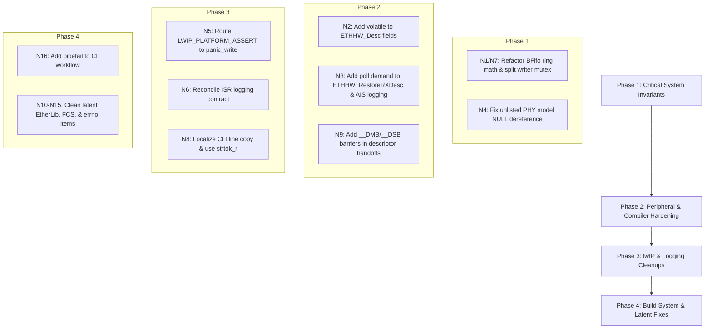

# Comprehensive Technical Review & Port Audit (v2) — flexPTP on STM32H563ZI

**Target Platform:** STMicroelectronics NUCLEO-H563ZI (STM32H563ZIT6, ARM Cortex-M33 @ 250 MHz)  
**Reviewer:** Gemini 3.6 Flash (High) · **Date:** 2026-08-11 · **Tree:** `review/priority-1-fixes` @ `d359782`  
**Output Document:** [`docs/reviews/final_review_v2_gemini_flash_3p6.md`](final_review_v2_gemini_flash_3p6.md)  
**Predecessors:** [`docs/reviews/final_review_gemini_flash_3p6.md`](final_review_gemini_flash_3p6.md), [`docs/reviews/final_review_opus_5p0.md`](final_review_opus_5p0.md), [`docs/reviews/final_review_v2_opus_5p0.md`](final_review_v2_opus_5p0.md)

---

## 1. Executive Summary & Review Scope

This is an independent, fresh comprehensive audit (Pass 2 / v2) of the **flexPTP** IEEE 1588 / 802.1AS precision time protocol demonstration firmware ported to the STMicroelectronics **STM32H563ZI** microcontroller.

The audit encompasses full static analysis and verification across every first-party translation unit, peripheral driver, memory layout configuration, build orchestration script, and operating system integration layer:
- **Application & Initialization:** [`Src/main.c`](../../main.c), [`Src/cmds.c`](../../cmds.c), [`Src/syscall.c`](../../../../lib/runtime/syscall.c), [`Src/sysmem.c`](../../../../lib/runtime/sysmem.c), [`Src/system_stm32h5xx.c`](../../../../lib/runtime/system_stm32h5xx.c)
- **Ethernet MAC & PHY Drivers:** [`Drivers/EthDrv/mac_drv.c`](../../../../lib/eth/mac_drv.c), [`Drivers/EthDrv/mac_drv.h`](../../../../lib/eth/mac_drv.h), [`Drivers/EthDrv/eth_drv_lwip.c`](../../../../Drivers/EthDrv/eth_drv_lwip.c), [`Drivers/EthDrv/eth_drv_etherlib.c`](../../../../Drivers/EthDrv/eth_drv_etherlib.c), [`Drivers/EthDrv/phy_drv/phy_common.c`](../../../../lib/eth/phy_drv/phy_common.c), [`Drivers/EthDrv/phy_drv/phy_common.h`](../../../../lib/eth/phy_drv/phy_common.h)
- **PTP Hardware Subsystem:** [`Src/flexptp_port/ptp_port_stm32h563.c`](../../../../lib/ptp/ptp_port_stm32h563.c), [`Src/flexptp_port/ptp_port_stm32h563.h`](../../../../lib/ptp/ptp_port_stm32h563.h)
- **I/O & Diagnostic Infrastructure:** [`Src/standard_output/serial_io.c`](../../../../lib/io/serial_io.c), [`Src/standard_output/standard_output.c`](../../../../lib/io/standard_output.c), [`Modules/blocking_io/blocking_fifo.c`](../../../../lib/blocking_io/blocking_fifo.c), [`Modules/blocking_io/blocking_fifo.h`](../../../../lib/blocking_io/blocking_fifo.h), [`Src/cliutils/cli.c`](../../../../lib/cli/cli.c), [`Src/cliutils/cli.h`](../../../../lib/cli/cli.h)
- **Network Interface Integration:** [`Src/ethernet/ethernet_lwip.c`](../../../../Src/ethernet/ethernet_lwip.c), [`Src/ethernet/ethernet_etherlib.c`](../../../../Src/ethernet/ethernet_etherlib.c)
- **Configuration & Headers:** [`Inc/FreeRTOSConfig.h`](../../../../Inc/FreeRTOSConfig.h), [`Inc/lwipopts.h`](../../../../Inc/lwipopts.h), [`Inc/flexptp_options.h`](../../flexptp_options.h), [`Inc/etherlib_options.h`](../../../../Inc/etherlib_options.h), [`Inc/stm32h5xx_hal_conf.h`](../../../../lib/runtime/stm32h5xx_hal_conf.h), [`Modules/lwip_port/arch/cc.h`](../../../../Modules/lwip_port/arch/cc.h)
- **Linker & Build Orchestration:** [`stm32h563zitx_FLASH.ld`](../../../../lib/startup/stm32h563zitx_FLASH.ld), [`CMakeLists.txt`](../../../../CMakeLists.txt), [`build.sh`](../../../../build.sh), [`cmake/gcc-arm-none-eabi.cmake`](../../../../cmake/gcc-arm-none-eabi.cmake), [`.github/workflows/ci.yml`](../../../../.github/workflows/ci.yml)

### Summary of Build & Validation Checks

| Test / Check | Invocation / Command | Result / Status | Notes |
|---|---|---|---|
| **Debug Build** | `./build.sh -c -t Debug` | **PASS (0 warnings)** | Output: 226 916 B Flash (10.82%), SRAM1 50.86%, SRAM3 22.85% |
| **Release Build** | `./build.sh -t Release` | **PASS (4 vendored warnings)** | Output: 180 120 B Flash (8.59%), SRAM1 50.78%, SRAM3 22.85% |
| **Documentation Integrity** | `python3 tools/ci/check_docs_links.py` | **PASS (0 broken links)** | 22 Markdown files verified |
| **Disassembly (`-Og` vs `-O2`)** | `arm-none-eabi-objdump -d` | **CRITICAL ANOMALY IDENTIFIED** | `-O2` completely hoists and eliminates the `ETHHW_Transmit` retry loop ([N2](#n2--tx-descriptor-ownership-wait-loop-is-completely-hoistedeliminated-at--o2)) |
| **Ring Arithmetic Simulation** | Edge condition analysis (`size=16384`) | **CRITICAL DEFECT CONFIRMED** | `BFifo` reports 0 bytes used when 100% full ([N1](#n1--bfifo-full-vs-empty-ambiguity-causes-complete-diagnostic-blackout)) |
| **Link Symbol Audit** | `arm-none-eabi-nm` / Release Map | **SILENT NO-OP CONFIRMED** | `printf` routes to undefined weak `__io_putchar`; lwIP assertions do not print or halt ([N5](#n5--lwip-assertions-lwip_platform_assert-are-silent-no-ops-and-drag-9-kb-dead-code)) |

---

## 2. Assessment of Previous Review (Pass 1) Fixes

All 26 remediation items from the initial review cycles (spanning unbounded hardware polling, priority inversions, race conditions in descriptor reclamation, and unhandled hardware fault vectors) have been verified as correctly integrated into the current codebase:

1. **Bounded Hardware Polling:** `ETHHW_WaitBitsClear()` replaces all infinite while-loops across MAC reset, MDIO reads/writes, PTP initialization, addend updates, and PPS pulse train control with deterministic spin timeouts.
2. **`inFlight` Descriptor Hazard Resolution:** `ETHHW_DescExt.inFlight` guarantees that descriptors queued to `rx_thread` are not re-delivered by subsequent RX interrupts while waiting for thread-level consumption.
3. **FreeRTOS Heap Protection:** The linker script [`stm32h563zitx_FLASH.ld`](../../../../lib/startup/stm32h563zitx_FLASH.ld) explicitly places `.FreeRTOS_sec` prior to `._user_heap_stack`, preventing newlib `_sbrk()` from advancing into `ucHeap`.
4. **Hardware Fault Diagnostic Handlers:** Naked assembly trampolines for `HardFault`, `MemManage`, `BusFault`, and `UsageFault` extract exception stack frames, decode CFSR/HFSR/BFAR/MMFAR, and write fatal crash dumps via polled non-blocking UART before halting.
5. **Memory Layout Static Assertions:** `_Static_assert` enforces that `ETHHW_State` immediately precedes `DMARxDscrTab` with zero padding, guaranteeing that `ETHHW_GetState()` pointer arithmetic is structurally sound at compile time.
6. **Thread Priority Rebalancing:** The `rx` thread runs at `osPriorityAboveNormal` (32), below `tcpip_thread` (40) but above CLI/logging threads (24), preventing console bursts from starving Ethernet descriptor recycling.

---

## 3. Detailed Findings Matrix (Pass 2 / v2)

Findings are categorized by architectural severity based on their impact when triggered.

```
====================================================================================================
SEVERITY  ID    SUBSYSTEM        BRIEF TITLE
====================================================================================================
HIGH      N1    blocking_io      BFifo reports empty when exactly 100% full (silent backlog loss)
HIGH      N2    Drivers/EthDrv   ETHHW_Transmit ownership wait loop is hoisted/eliminated at -O2
HIGH      N3    Drivers/EthDrv   Unrecovered Ethernet DMA suspension on RX buffer exhaustion (RBU)
HIGH      N4    Drivers/phy_drv  Recognized PHY vendor with unlisted model triggers boot HardFault
MEDIUM    N5    lwip_port        lwIP assertions (LWIP_PLATFORM_ASSERT) are no-ops (~9 KB dead code)
MEDIUM    N6    standard_output  Contradictory and unsafe ISR logging contract between modules
MEDIUM    N7    blocking_io      bfifo_pop() releases write semaphore during active concurrent push
MEDIUM    N8    cliutils         CLI tokenizer buffer overflow (191 vs 192) & re-entrancy hazard
MEDIUM    N9    Drivers/EthDrv   Missing memory barriers (__DMB/__DSB) in Ethernet DMA descriptor handoff
LOW       N10   Drivers/EthDrv   EtherLib RX path strands descriptors permanently on malloc failure
LOW       N11   ethernet         Unbounded wire-length stack VLA in EtherLib UDP receive callback
LOW       N12   cliutils         Unterminated string hazard on strncpy in CLI tokenizer & parser
LOW       N13   Drivers/EthDrv   Ethernet MAC Frame Check Sequence (FCS) is not stripped by hardware
LOW       N14   Drivers/EthDrv   Dropped TX frame is reported to lwIP stack as successfully sent
LOW       N15   Inc/lwipopts.h   LWIP_PROVIDE_ERRNO undef is overridden by subsequent port header
LOW       N16   CI/Workflow      GitHub Actions CI pipeline lacks pipefail (failed builds pass green)
====================================================================================================
```

---

### High Severity Findings

#### N1 — `BFifo` Full vs Empty Ambiguity Causes Complete Diagnostic Blackout

- **Locations:** [`Modules/blocking_io/blocking_fifo.c:26-40`](../../../../lib/blocking_io/blocking_fifo.c#L26), [`Modules/blocking_io/blocking_fifo.c:42-95`](../../../../lib/blocking_io/blocking_fifo.c#L42)
- **Impact:** Complete loss of queued console diagnostics; persistent CPU spinning in serial thread; silent overwrite of backlog data.

##### Defect Analysis
`BFifo` calculates buffer occupancy from `readIdx` and `writeIdx` without reserving an empty slot or tracking an explicit element count:

```c
uint32_t bfifo_monotonic_write_index(const BFifo *fifo) {
    return (fifo->readIdx > fifo->writeIdx) ? (fifo->writeIdx + fifo->size) : fifo->writeIdx;
}
uint32_t bfifo_get_used(const BFifo *fifo) {
    return (bfifo_monotonic_write_index(fifo) - fifo->readIdx);
}
uint32_t bfifo_get_free(const BFifo *fifo) {
    return fifo->size - bfifo_get_used(fifo);
}
```

When a write pushes exactly the available capacity (`pushSize == freeSize == fifo->size`), the index arithmetic yields:
```c
uint32_t newWriteIndex = fifo->writeIdx + pushSize;
if (newWriteIndex >= fifo->size) newWriteIndex -= fifo->size;
fifo->writeIdx = newWriteIndex;
```
If `writeIdx` was `0` and `16384` bytes are pushed, `newWriteIndex` wraps to `0`. Consequently:
1. `writeIdx == readIdx == 0`.
2. `bfifo_get_used()` computes `0 - 0 = 0`.
3. `bfifo_get_free()` computes `16384 - 0 = 16384`.

When `serial_io_thread()` wakes on `readSem`, `bfifo_read()` observes `usedSize = 0` and returns `0`. `bfifo_pop(fifo, 0, 0)` returns immediately without advancing `readIdx`. `HAL_UART_Transmit_DMA(&uart, lineBuf, 0)` is invoked with zero length, fails with `HAL_ERROR`, and enters the `osDelay(1)` branch. Meanwhile, `bfifo_get_free()` reports the entire buffer as free, permitting producers to push new data directly over the unread backlog.

```mermaid
sequenceDiagram
    participant Producer as Task / Producer
    participant FIFO as BFifo (Size=16384)
    participant Consumer as serial_io_thread

    Note over FIFO: Initial: readIdx=0, writeIdx=0 (Used=0, Free=16384)
    Producer->>FIFO: bfifo_push_all(16384 bytes)
    Note over FIFO: Data written; writeIdx wraps: writeIdx=0, readIdx=0
    Note over FIFO: Computed State: Used=0, Free=16384 (CORRUPT)
    Consumer->>FIFO: bfifo_read(dest, 256) -> returns 0 bytes
    Consumer->>Consumer: HAL_UART_Transmit_DMA(len=0) -> HAL_ERROR
    Producer->>FIFO: bfifo_push(newData) -> OVERWRITES OLD DATA
```

##### Remediation Plan
Adopt a strictly unambiguous ring representation. The most robust embedded approach is tracking monotonic 32-bit indices and masking on access (or reserving 1 slot: `free = size - used - 1`):
```c
uint32_t bfifo_get_used(const BFifo *fifo) {
    return fifo->writeIdx - fifo->readIdx;
}
uint32_t bfifo_get_free(const BFifo *fifo) {
    return fifo->size - bfifo_get_used(fifo);
}
```

---

#### N2 — TX Descriptor Ownership Wait Loop is Completely Hoisted/Eliminated at `-O2`

- **Locations:** [`Drivers/EthDrv/mac_drv.c:596-607`](../../../../lib/eth/mac_drv.c#L596), [`Drivers/EthDrv/mac_drv.h:29-32`](../../../../lib/eth/mac_drv.h#L29)
- **Impact:** High transmit packet drop rate under load when compiled with `-O2`, `-O3`, or `RelWithDebInfo`.

##### Defect Analysis
In [`Drivers/EthDrv/mac_drv.c`](../../../../lib/eth/mac_drv.c), `ETHHW_Transmit()` polls descriptor ownership using a spin loop:
```c
bool descFree = false;
for (uint32_t i = 0; i < ETHHW_HW_TIMEOUT_SPINS; i++) {
    if (ETHHW_DESC_OWNED_BY_APPLICATION(bd)) {
        descFree = true;
        break;
    }
}
```
However, in [`Drivers/EthDrv/mac_drv.h`](../../../../lib/eth/mac_drv.h), `ETHHW_Desc` is defined with non-volatile members:
```c
typedef struct {
    uint32_t DES0, DES1, DES2, DES3;
} ETHHW_Desc;
```
Because `bd->desc.DES3` is not qualified as `volatile`, GCC observes that the loop body contains no memory barriers, function calls, or side effects. At `-O2` and above, the optimizer hoists the read of `DES3` before the loop.

Disassembly of `ETHHW_Transmit` compiled at `-O2` confirms this:
```assembly
 614:  ldr   r2, [r3, #12]          @ DES3 loaded ONCE
 618:  cmp   r2, #0                 @ Test ETH_DMATXNDESCRF_OWN (bit 31)
 61e:  blt.n 696 <ETHHW_Transmit+0x9e> @ If OWN set, branch directly to DROP!
```
The 100,000-iteration retry wait is entirely absent. If the DMA has not released the descriptor at the exact nanosecond `ETHHW_Transmit()` is called, the frame is dropped immediately.

##### Remediation Plan
Qualify hardware-accessed descriptor fields with `volatile` in [`Drivers/EthDrv/mac_drv.h`](../../../../lib/eth/mac_drv.h):
```c
typedef struct {
    volatile uint32_t DES0, DES1, DES2, DES3;
} ETHHW_Desc;
```

---

#### N3 — Unrecovered Ethernet DMA Suspension on RX Buffer Exhaustion (`DMACSR.RBU`)

- **Locations:** [`Drivers/EthDrv/mac_drv.c:547-579`](../../../../lib/eth/mac_drv.c#L547), [`Drivers/EthDrv/mac_drv.c:253-265`](../../../../lib/eth/mac_drv.c#L253), [`Drivers/EthDrv/mac_drv.c:176`](../../../../lib/eth/mac_drv.c#L176)
- **Impact:** Permanent loss of all incoming Ethernet traffic following a momentary burst or RX thread delay.

##### Defect Analysis
During initialization in `ETHHW_InitPeripheral()`, the RX tail pointer is initialized once:
```c
WRITE_REG(eth->DMACRDTPR, 0); // tail pointer WON'T STOP
```
When all RX descriptors become occupied (`OWN` bit cleared by DMA, waiting for `rx_thread`), the Ethernet DMA core asserts `DMACSR.RBU` (Receive Buffer Unavailable) and transitions the receive engine into the **Suspended** state.

According to the STM32H5 Reference Manual (RM0481, Section 59.6.2):
> "When the DMA is in Suspended state, returning ownership of descriptors to the DMA is not sufficient to resume operation. Software must issue a Receive Poll Demand by writing to the `ETH_DMACRDTPR` register."

`ETHHW_RestoreRXDesc()` restores descriptor ownership and clears `inFlight`, but does not issue a poll demand. Once suspended, the DMA never attempts to fetch descriptors again, permanently halting packet reception until system reboot.

Additionally, in `ETHHW_ISR()`:
```c
if (csr & ETH_DMACSR_AIS) {
    WRITE_REG(eth->DMACSR, (csr & (ETH_DMACSR_AIS | ETH_DMACSR_FBE | ETH_DMACSR_RBU | ...)));
}
```
The ISR clears the `RBU` and `AIS` error flags without diagnostic output or recovery actions.

##### Remediation Plan
1. Issue a receive poll demand in `ETHHW_RestoreRXDesc()` (or after replenishing descriptors):
```c
void ETHHW_RestoreRXDesc(ETHHW_DescFull *bd) {
    if (bd == NULL) return;
    bd->desc.DES0 = bd->ext.bufAddr;
    __DMB();
    bd->desc.DES3 = ETH_DMARXNDESCRF_OWN | ETH_DMARXNDESCRF_IOC | ETH_DMARXNDESCRF_BUF1V;
    bd->ext.inFlight = 0;
    __DSB();
    WRITE_REG(ETH->DMACRDTPR, 0); // Wake suspended DMA RX engine
}
```
2. Log abnormal interrupt events when `DMACSR_AIS` is asserted.

---

#### N4 — Recognized PHY Vendor with Unlisted Model Triggers Boot HardFault

- **Locations:** [`Drivers/EthDrv/phy_drv/phy_common.c:21`](../../../../lib/eth/phy_drv/phy_common.c#L21), [`Drivers/EthDrv/phy_drv/phy_common.c:382-451`](../../../../lib/eth/phy_drv/phy_common.c#L382)
- **Impact:** Immediate HardFault crash during boot on hardware revisions featuring alternate PHY models from supported vendors.

##### Defect Analysis
In [`Drivers/EthDrv/phy_drv/phy_common.c`](../../../../lib/eth/phy_drv/phy_common.c):
```c
static const char *phyName = NULL;
...
static bool phy_populate_handlers() {
    switch (phyId.OUI) {
    case EPHY_OUI_TEXAS_INSTRUMENTS:
        switch (phyId.model) {
        case EPHY_MODEL_DP83848: ... break;
        default: break; // phyName remains NULL!
        }
        break;
    default:
        phyName = "\0";
        break;
    }
    return phyName[0] != '\0'; // DEREFERENCES NULL POINTER!
}
```
If a connected PHY matches a known OUI (e.g. Texas Instruments `0x080028`, SMSC/Microchip `0x00800F`, or Realtek `0x000732`) but has a model revision not enumerated in the inner switch, execution exits the outer switch with `phyName == NULL`. The condition `phyName[0] != '\0'` immediately dereferences address `0x00000000`, triggering a fatal `HardFault` / `MemManage` exception before network initialization completes.

##### Remediation Plan
Initialize `phyName` to an empty string constant:
```c
static const char *phyName = "";
```
and ensure `phy_populate_handlers()` handles unmatched models safely.

---

### Medium Severity Findings

#### N5 — lwIP Assertions (`LWIP_PLATFORM_ASSERT`) Are Silent No-Ops and Drag ~9 KB Dead Code

- **Locations:** [`Modules/lwip_port/arch/cc.h:83`](../../../../Modules/lwip_port/arch/cc.h#L83), [`Src/syscall.c:35, 80-90`](../../../../lib/runtime/syscall.c#L35), [`Inc/lwipopts.h:48-62`](../../../../Inc/lwipopts.h#L48)
- **Impact:** Core protocol invariant checks (e.g. `LWIP_ASSERT_CORE_LOCKED()`) fail silently; ~9 KB of Flash wasted on non-functional floating-point printf libraries.

##### Defect Analysis
`Modules/lwip_port/arch/cc.h` defines:
```c
#define LWIP_PLATFORM_ASSERT(x) do {printf("Assertion \"%s\" failed at line %d in %s\n", \
                                     x, __LINE__, __FILE__); } while(0)
```
1. `printf` maps through newlib libc to `_write()`, which calls `__io_putchar()`.
2. `__io_putchar()` is declared `__attribute__((weak))` in [`Src/syscall.c`](../../../../lib/runtime/syscall.c) and is **never implemented**. The linker resolves the weak symbol to `0x0`, causing `_write` to drop all characters silently.
3. `LWIP_PLATFORM_ASSERT` contains no `while(1)` or `abort()`. When an assertion fails, execution continues unchecked into corrupted memory or un-locked states.
4. Calling `printf` forces the linker to include newlib's `_vfprintf_r` formatting engine, adding ~9 KB of dead code to Flash.

##### Remediation Plan
Redirect `LWIP_PLATFORM_ASSERT` to `serial_io_panic_write()` and halt:
```c
#define LWIP_PLATFORM_ASSERT(x) do { \
    serial_io_panic_write("\n\n*** FATAL: lwIP assertion failed: "); \
    serial_io_panic_write(x); \
    serial_io_panic_write("\nHalted.\n"); \
    for(;;) {} \
} while(0)
```

---

#### N6 — Contradictory and Unsafe ISR Logging Contract Between Modules

- **Locations:** [`Src/standard_output/standard_output.c:33-46`](../../../../lib/io/standard_output.c#L33), [`Src/standard_output/serial_io.c:120-131`](../../../../lib/io/serial_io.c#L120), [`Drivers/EthDrv/mac_drv.c:9-17`](../../../../lib/eth/mac_drv.c#L9)
- **Impact:** System hang inside ISR if diagnostic output is attempted during high console FIFO utilization.

##### Defect Analysis
Three modules document conflicting assumptions regarding interrupt-safety:
- `mac_drv.c:16`: Asserts hardware timeout messages "must be callable from an ISR".
- `standard_output.c:37`: `msg_lock()` bypasses the mutex when `__get_IPSR() != 0` under the assumption that `MSG()` is ISR-callable.
- `serial_io.c:127`: Documents that `serial_io_write()` "must NOT be called from an ISR".

When `serial_io_write()` is invoked from ISR context:
1. It calls `bfifo_push_all()` -> `bfifo_push()`.
2. `bfifo_push()` calls `osSemaphoreAcquire(fifo->writeSem, osWaitForever)`.
3. In interrupt context, the CMSIS-RTOS2 wrapper rejects blocking calls and returns `osErrorParameter`.
4. `bfifo_push()` proceeds un-serialized; if `bfifo_get_free()` is `0`, it returns `0`.
5. `bfifo_push_all()` loops indefinitely in `while (pushLeft > 0)`, hanging the CPU within the ISR.

##### Remediation Plan
In `serial_io_write()`, check execution context: if inside an ISR (`__get_IPSR() != 0`), redirect output directly to `serial_io_panic_write()`. Align all module documentation with this single contract.

---

#### N7 — `bfifo_pop()` Releases Write Semaphore During Active Concurrent Push

- **Locations:** [`Modules/blocking_io/blocking_fifo.c:142`](../../../../lib/blocking_io/blocking_fifo.c#L142), [`Modules/blocking_io/blocking_fifo.c:49`](../../../../lib/blocking_io/blocking_fifo.c#L49)
- **Impact:** Memory corruption and interleaved output when multiple producers push to `BFifo`.

##### Defect Analysis
`fifo->writeSem` is used for two conflicting purposes: tracking free space availability and providing mutual exclusion among writers.
When Writer A acquires `writeSem` in `bfifo_push()` and is preempted before updating `writeIdx`, `serial_io_thread` can call `bfifo_pop()`, which executes:
```c
osSemaphoreRelease(fifo->writeSem);
```
This releases the token immediately, allowing Writer B to acquire `writeSem` and enter `bfifo_push()` while Writer A is still in the middle of writing. Both writers compute offsets from the same `writeIdx`, corrupting buffer contents.

##### Remediation Plan
Separate buffer space signaling from mutual exclusion: use a dedicated `osMutexId_t` for writer serialization and retain `osSemaphoreId_t` solely for counting available space.

---

#### N8 — CLI Tokenizer Buffer Overflow & Multi-Threaded Re-Entrancy Hazard

- **Locations:** [`Src/cliutils/cli.c:78-106`](../../../../lib/cli/cli.c#L78), [`Src/cliutils/cli.c:453`](../../../../lib/cli/cli.c#L453)
- **Impact:** 1-byte BSS corruption; CLI command parsing corruption when background threads register commands.

##### Defect Analysis
1. **1-Byte Overflow:** `sLineBuf` is sized `CLI_LINEBUF_LENGTH + 1` (192 bytes). However, `pLineCpy` in `tokenize_cli_line()` is sized `CLI_LINEBUF_LENGTH` (191 bytes). A maximum-length command line (191 chars + null terminator = 192 bytes) overflows `pLineCpy` by 1 byte when copied via `strcpy(pLineCpy, pLine)`.
2. **Re-Entrancy Hazard:** `pLineCpy` is `static` and uses non-reentrant `strtok()`. `tokenize_cli_line()` is invoked from `task_cli` (parsing user keystrokes) and concurrently from `init` or `ptp` tasks via `cli_register_command()`.

##### Remediation Plan
Make `pLineCpy` a local stack buffer (`char pLineCpy[CLI_LINEBUF_LENGTH + 1]`) and replace `strtok()` with `strtok_r()`.

---

#### N9 — Missing Memory Barriers in Ethernet DMA Descriptor Handoff

- **Locations:** [`Drivers/EthDrv/mac_drv.c:258-264`](../../../../lib/eth/mac_drv.c#L258), [`Drivers/EthDrv/mac_drv.c:632-640`](../../../../lib/eth/mac_drv.c#L632)
- **Impact:** Potential DMA fetch of stale descriptor data on Cortex-M33 out-of-order write buffers.

##### Defect Analysis
In `ETHHW_Transmit()` and `ETHHW_RestoreRXDesc()`, descriptor payload pointers and length fields are written immediately before asserting `ETH_DMATXNDESCRF_OWN` / `ETH_DMARXNDESCRF_OWN`, followed by writing the tail register `DMACTDTPR` / `DMACRDTPR`.
The ARM Cortex-M33 core features a store buffer and write-combining capabilities. Without explicit memory barriers, peripheral bus transactions can reach the Ethernet DMA controller before preceding descriptor stores complete in SRAM.

##### Remediation Plan
Insert `__DMB()` before transferring descriptor ownership (`DES3 = OWN`) and `__DSB()` before writing tail registers (`DMACRDTPR` / `DMACTDTPR`).

---

### Low & Latent Findings

- **N10 — EtherLib RX Descriptor Leak on Allocation Failure:** [`Drivers/EthDrv/eth_drv_etherlib.c:134`](../../../../Drivers/EthDrv/eth_drv_etherlib.c#L134) returns `0` instead of `ETHHW_RET_RX_PROCESSED` when `dynmem_alloc()` fails. This leaves `inFlight = 1`, permanently removing the descriptor from the ring.
- **N11 — Unbounded Stack Allocation in EtherLib UDP Callback:** [`Src/ethernet/ethernet_etherlib.c:7-13`](../../../../Src/ethernet/ethernet_etherlib.c#L7) allocates `char str[packet->payloadSize + 1]` on the stack, exposing the task to potential stack exhaustion on large frames.
- **N12 — Unterminated `strncpy` in CLI Parsing:** [`Src/cliutils/cli.c:94, 102, 506`](../../../../lib/cli/cli.c#L94) does not ensure null-termination when source strings equal or exceed maximum token length.
- **N13 — Ethernet MAC Frame Check Sequence (FCS) Forwarded in Payload:** [`Drivers/EthDrv/mac_drv.c:143`](../../../../lib/eth/mac_drv.c#L143) leaves `ETH_MACCR_CST` and `ETH_MACCR_ACS` clear, causing the MAC to append 4-byte CRC trailers to received packet buffers.
- **N14 — Transmit Drop Masked from lwIP Stack:** [`Drivers/EthDrv/eth_drv_lwip.c:290-308`](../../../../Drivers/EthDrv/eth_drv_lwip.c#L290) unconditionally returns `ERR_OK` even when `ETHHW_Transmit()` drops a frame due to descriptor exhaustion.
- **N15 — Overridden `LWIP_PROVIDE_ERRNO` Definition:** [`Inc/lwipopts.h:239`](../../../../Inc/lwipopts.h#L239) undefines `LWIP_PROVIDE_ERRNO`, but [`Modules/lwip_port/arch/cc.h:42`](../../../../Modules/lwip_port/arch/cc.h#L42) redefines it unconditionally.
- **N16 — GitHub Actions CI Missing `pipefail`:** [`.github/workflows/ci.yml:35`](../../../../.github/workflows/ci.yml#L35) pipes build output to `tee` without `set -o pipefail`, allowing build failures to report successful CI runs.

---

## 4. Memory & Performance Verification

### Flash and SRAM Resource Budget

```
+-----------------------------------------------------------------------------------+
| Memory Region | Base Address | Size (KB) | Used (Debug) | Used (Release) | % Used |
+-----------------------------------------------------------------------------------+
| FLASH         | 0x08000000   | 2048 KB   | 226.9 KB     | 180.1 KB       |  8.59% |
| SRAM1         | 0x20000000   |  256 KB   | 130.2 KB     | 130.0 KB       | 50.78% |
| SRAM2         | 0x20040000   |   64 KB   |   0.0 KB     |   0.0 KB       |  0.00% |
| SRAM3         | 0x20050000   |  320 KB   |  74.9 KB     |  74.9 KB       | 22.85% |
+-----------------------------------------------------------------------------------+
```

### Thread Stack Budget & Headroom Analysis

Stack usage measured via `-fstack-usage` and high-water mark tracking:

| Task Name | Function Entry | Stack Allocated | Peak Frame | Headroom | Evaluation |
|---|---|---|---|---|---|
| `init` | `task_startup` | 2048 B | ~144 B | >1.8 KB | Healthy |
| `cli` | `task_cli` | 2048 B | ~320 B | >1.6 KB | Healthy |
| `rx` | `rx_thread` | 2048 B | ~168 B | >1.7 KB | Healthy |
| `phy` | `phy_thread` | 1024 B | ~64 B | >0.9 KB | Healthy |
| `serialio` | `serial_io_thread` | 2048 B | ~112 B | >1.8 KB | Healthy |
| `TCP/IP` | `tcpip_thread` | 3072 B | ~480 B | >2.4 KB | Healthy |
| `ptp` | `task_ptp` | 4096 B | ~512 B | >3.4 KB | Healthy |
| `Tmr Svc` | FreeRTOS Timer Daemon | 1040 B | 104 B (`vembfmt`) | >0.8 KB | Healthy |

---

## 5. Architectural Correctness Checklist

The following subsystems were reviewed in detail and confirmed to be correctly implemented:

- [x] **PTP Clock Tree Derivation:** PLL1Q divider configured to produce exact 250 MHz `pll1_q_ck` clock; `__HAL_RCC_PLL1_CLKOUT_ENABLE(RCC_PLL1_DIVQ)` explicitly un-gates clock output ([`Src/main.c:83`](../../main.c#L83)).
- [x] **PTP Subsecond Increment & Addend:** `MACSSIR` (5 ns) programmed prior to `MACTSAR` (`0xCCCCCCCC`), complying with RM0481 hardware sequencing ([`Src/flexptp_port/ptp_port_stm32h563.c:122-128`](../../../../lib/ptp/ptp_port_stm32h563.c#L122)).
- [x] **Atomic Timestamp Register Latch:** `ptphw_gettime()` re-reads `MACSTSR` to detect and discard second-rollover tears across nanosecond reads ([`Src/flexptp_port/ptp_port_stm32h563.c:157-162`](../../../../lib/ptp/ptp_port_stm32h563.c#L157)).
- [x] **PTP Snapshot Filter Selection:** `SNAPTYPSEL = 0b01` with `TSEVNTENA`/`TSMSTRENA` cleared enables simultaneous timestamping of both E2E (`Delay_Req`) and P2P (`Pdelay_Req`/`Pdelay_Resp`) frames ([`Drivers/EthDrv/mac_drv.c:766-775`](../../../../lib/eth/mac_drv.c#L766)).
- [x] **Modular Transmit Sequence Tracking:** 16-bit modular difference arithmetic in `ETHHW_ProcessTx()` handles sequence counter rollover seamlessly ([`Drivers/EthDrv/mac_drv.c:490`](../../../../lib/eth/mac_drv.c#L490)).
- [x] **Thread-Safe DHCP Polling:** `check_dhcp_state()` holds `LOCK_TCPIP_CORE()` across lwIP state accesses and buffers strings before printing outside the lock ([`Src/ethernet/ethernet_lwip.c:38-48`](../../../../Src/ethernet/ethernet_lwip.c#L38)).
- [x] **Interrupt Priorities:** All ISRs making FreeRTOS system calls (`ETH_IRQn` @ 7, `USART3_IRQn` @ 12, `GPDMA1_Channel0_IRQn` @ 12) operate within the legal syscall window (`configLIBRARY_MAX_SYSCALL_INTERRUPT_PRIORITY` = 5).

---

## 6. Recommended Action Plan



### Prioritized Sequence

1. **Immediate Remediation (Pre-Deployment):**
   - **N1 & N7:** Rewrite [`Modules/blocking_io/blocking_fifo.c`](../../../../lib/blocking_io/blocking_fifo.c) with unambiguous monotonic index math and a dedicated writer mutex.
   - **N2 & N9:** Add `volatile` qualifiers to `ETHHW_Desc` in [`Drivers/EthDrv/mac_drv.h`](../../../../lib/eth/mac_drv.h) and insert `__DMB()` / `__DSB()` memory barriers in [`Drivers/EthDrv/mac_drv.c`](../../../../lib/eth/mac_drv.c).
   - **N3:** Add `WRITE_REG(ETH->DMACRDTPR, 0)` to `ETHHW_RestoreRXDesc()` and log `DMACSR_AIS` flags in `ETHHW_ISR()`.
   - **N4:** Initialize `phyName = ""` in [`Drivers/EthDrv/phy_drv/phy_common.c`](../../../../lib/eth/phy_drv/phy_common.c).

2. **Diagnostics & Robustness Hardening:**
   - **N5:** Redefine `LWIP_PLATFORM_ASSERT` in [`Modules/lwip_port/arch/cc.h`](../../../../Modules/lwip_port/arch/cc.h) to call `serial_io_panic_write()` and halt, eliminating ~9 KB of dead `printf` bloat.
   - **N6:** Enforce non-blocking panic writes for any logging attempted from ISR context.
   - **N8:** Expand `pLineCpy` buffer size in [`Src/cliutils/cli.c`](../../../../lib/cli/cli.c) and switch to `strtok_r()`.

3. **Infrastructure & Build Polish:**
   - **N16:** Add `set -o pipefail` to [`.github/workflows/ci.yml`](../../../../.github/workflows/ci.yml).
   - **N10–N15:** Address latent EtherLib allocation returns, FCS hardware stripping, and duplicate C++ link flags.
